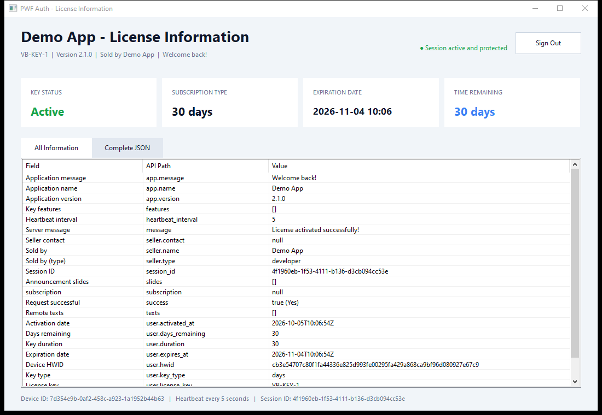
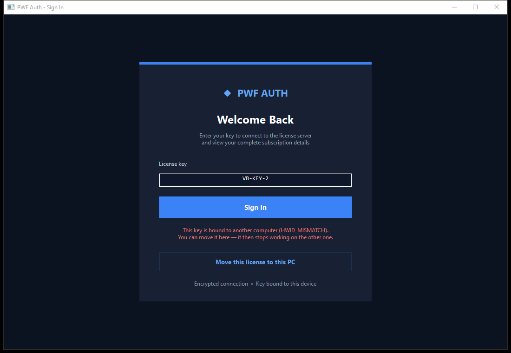

<p align="center"><a href="README.md">English</a> · <a href="README.zh-CN.md">简体中文</a> · <a href="README.tr.md">Türkçe</a> · <b>العربية</b></p>
<p align="center">شروحات بالفيديو: <a href="https://www.youtube.com/@pwfauth">youtube.com/@pwfauth</a></p>

# مثال PWF Auth لسطح المكتب بلغة C++ الأصلية

تطبيق سطح مكتب لـ Windows بواجهة إنجليزية، مكتوب بلغة C++17 الأصلية. يتبع مسار الترخيص نفسه الذي تتبعه أمثلة C# وPython:

- تسجيل دخول مشفّر بمفتاح الترخيص وربطه بمعرّف الجهاز (HWID)؛
- تحقق دوري (heartbeat) مباشر، والخادم هو من ينهي الجلسة (الإيقاف عن بُعد)؛
- نقل الترخيص إلى جهاز جديد؛
- ملخص كامل للترخيص، وجدول مسطّح بحقول الرد، ونص JSON الخام؛
- تسجيل خروج صريح يحرّر الجلسة على الخادم



لا ينشر موقع PWF Auth حزمة لـ C++، لذلك يطبّق هذا المثال البروتوكول الموثّق مباشرةً عبر واجهات Windows:

- مكتبة WinHTTP لاتصالات HTTPS؛
- واجهة Windows CNG لـ SHA-256 وAES-256-CBC وHMAC-SHA256 وتوليد متجه تهيئة (IV) آمن؛
- القيمة `MachineGuid` من إعدادات التشفير في Windows كمعرّف للجهاز (وهي القيمة نفسها التي تستخدمها حزم .NET وPython وNode، فيُحسب الكمبيوتر الواحد جهازاً واحداً)؛
- المكتبة `nlohmann-json`، وتُستعاد تلقائياً عبر ملف vcpkg المرفق

الملفان `PwfClient.h` و`PwfClient.cpp` هما الجزء القابل لإعادة الاستخدام: انسخهما إلى تطبيقك

## ما يعرضه المثال

- **تسجيل الدخول بمفتاح الترخيص.** تربط الدالة `Login` المفتاح بهذا الكمبيوتر. بعدها تعرض لوحة المعلومات في التطبيق حالة المفتاح ونوعه وتاريخ انتهائه والوقت المتبقي، ومن باع المفتاح، وكل حقول الرد
- **الإيقاف عن بُعد.** تعمل الدالة `StartHeartbeat` بعد تسجيل الدخول. عندما تحظر المفتاح أو توقفه مؤقتاً أو تعيد ضبطه من لوحة التحكم، أو عندما تنتهي صلاحيته، يستدعي العميل دالة انتهاء الجلسة، ويعود التطبيق إلى صفحة تسجيل الدخول مع ذكر السبب
  - وحده الرد المشفّر يُعدّ جواباً. ثلاث نبضات متتالية بلا جواب تنهي الجلسة بالرمز `NETWORK_LOST`، أو بالرمز `CLOCK_SKEW` إذا ظل الخادم يرفض ساعة هذا الكمبيوتر. لذلك لا يمكن إبقاء مفتاح محظور شغّالاً بتغيير ساعة الجهاز
  - للرمز HTTP 429 حدّ خاص وأكبر (10 نبضات)، لأن عناوين IP المشتركة قد تتعرض لتحديد المعدّل لأسباب مشروعة
- **الساعة الخاطئة تُصحَّح تلقائياً.** عندما يرفض الخادم طلباً لأن ساعة الكمبيوتر متأخرة أو متقدمة أكثر من خمس دقائق، يرسل وقته هو. فيزيح العميل طوابعه الزمنية بمقدار الفرق ويعيد إرسال الطلب مرة واحدة
- **نقل الترخيص إلى جهاز جديد.** عندما يكون المفتاح مربوطاً بكمبيوتر آخر (`HWID_MISMATCH` أو `DEVICE_LIMIT`)، تعرض صفحة تسجيل الدخول الخيار **Move this license to this PC**. يستخدم هذا الخيار الدالة `ResetHardwareId` ثم يسجّل الدخول من جديد. وتنطبق مدة الانتظار التي يحددها المطوّر بين عمليتَي نقل (12 ساعة افتراضياً)

  

- **مصادقة مستقلة للخادم.** يجب أن يحمل كل رد توقيع RSA صالحاً من الخادم مربوطاً بهذا الطلب تحديداً. ومعرفة سر التطبيق لا تكفي لتزوير هذا التوقيع. وتُرفض الردود غير الموقّعة أو المعدّلة أو المُعاد إرسالها قبل تحليلها
- **رسائل خطأ واضحة** عند انقطاع الاتصال (`PwfNetworkError`)، وعند رفض سر التطبيق (HTTP 401)، وعند وصول رد ليس بصيغة JSON التي تعيدها الواجهة البرمجية (`PwfHttpError`)

## الإعداد

استبدل القيمة المؤقتة في أعلى `main.cpp`:

```cpp
constexpr char APP_SECRET[] = "YOUR_64_CHARACTER_APP_SECRET";
```

تجاوز الإعدادات عبر متغيرات البيئة معطّل في كل إعدادات البناء. لا يستخدم العميل إلا `https://pwfauth.com`، ويرفض أي عنوان بديل يُمرَّر إلى المُنشئ، ولا يتبع أي إعادة توجيه. اضبط سر التطبيق وقت البناء، ولا ترفع سراً حقيقياً إلى المستودع أبداً

يحتوي الملف `ServerPublicKey.h` على مفتاح التحقق العام المثبّت لنسخة الخادم المطابقة. أضفه مع `ProductionPolicy.h` عند نسخ PwfClient إلى مشروع آخر. دعم التوقيع المطابق منشور على خادم pwfauth.com. ويبقى مفتاح التوقيع الخاص على الخادم ولا يُوزَّع أبداً مع هذا العميل

## البناء والتشغيل

افتح `PWFAuthCpp.slnx` في Visual Studio، واختر `Debug | x64`، ثم اضغط `F5`. يستعيد المشروع اعتمادية vcpkg محلياً في أول عملية بناء

يُكتب الملف التنفيذي في:

```text
bin\Debug\PWFAuthCpp.exe
```

يُجري التطبيق اختباراً ذاتياً دون اتصال لدورة AES/HMAC كاملة قبل عرض نافذة تسجيل الدخول. أما تسجيل الدخول الحقيقي فيتطلب سر التطبيق ومفتاحاً صالحاً

## الشبكات المحجوبة (1.4، بتاريخ 2026-10-13)

بعض الشبكات تحجب الاسم `pwfauth.com` (شبكة Etisalat في الإمارات تجيب بأن النطاق غير موجود)، فلم يكن التطبيق يصل إلى خادم التراخيص دون VPN. صار `PwfClient` الآن يجرّب الخادم نفسه باسم ثانٍ، `https://pwfauth.net`، عندما لا يصل أي رد على الإطلاق من `pwfauth.com`:

- فقط عندما يكون مؤكداً أن الطلب لم يصل إلى أي خادم (الاسم لا يُحَلّ، أو لا اتصال، أو رُفض الاتصال الآمن)، أو عند انتهاء المهلة قبل أن يتلقى هذا العميل أي رد من قبل؛
- لا يُرسَل أي رد إلى الاسم الآخر، حتى لو كان رد خطأ؛
- بمجرد أن يجيب `pwfauth.net` يبقى العميل عليه حتى يُغلق؛
- الاسمان ثابتان في `ProductionPolicy.h`، والخادم ومفتاح التوقيع وكل فحوص الرد هي نفسها

انسخ الملفات الجديدة `PwfClient.cpp` و`PwfClient.h` و`ProductionPolicy.h` إلى تطبيقك وأعد البناء. لا شيء آخر يتغير

## الاتصالات المنقطعة (1.3.1، بتاريخ 2026-10-12)

عندما لا يتلقى الطلب أي رد على الإطلاق، وغالباً ما يكون السبب اتصالاً أُغلق في الطريق (خطأ Windows رقم 10054 أو خطأ WinHTTP رقم 12030)، يعيد `PwfClient` الآن إرسال الطلب نفسه مرة واحدة عبر اتصال جديد بعد 300 ms. في السابق كان هذا الاستدعاء يفشل بالاستثناء `PwfNetworkError` والرسالة "Cannot reach the license server". لا تُعاد المحاولة إلا في هذه الحالة: الرد (حتى رد الخطأ)، والرد الذي ينقطع أثناء قراءته، وانتهاء المهلة، لا يُرسل أي منها مرتين. ولم يتغير شيء آخر: مفتاح التوقيع نفسه والدوال نفسها

## حسابات العملاء (1.3، بتاريخ 2026-10-12)

إلى جانب مفاتيح الترخيص، يمكن أن يكون لعملائك حساب باسم مستخدم وكلمة مرور (فعّل حسابات العملاء للتطبيق من لوحة التحكم). صار في `PwfClient` الآن:

| الدالة | ما تفعله |
|---|---|
| `RegisterAccount(username, password, email)` | تنشئ حساباً |
| `RegisterAccountWithKey(username, password, key, email)` | تنشئ حساباً يأخذ مدة مفتاح (ويُستهلك المفتاح) |
| `AccountLogin(username, password)` | تسجّل دخول الحساب على هذا الكمبيوتر، ثم شغّل التحقق الدوري بعدها كما بعد `Login` |
| `ChangeAccountPassword(username, current, new)` | تغيّر كلمة المرور (ويُسجَّل خروج كل جلسات الحساب) |
| `RedeemKey(username, password, key)` / `RedeemKey(key)` | تضيف مدة مفتاح إلى حساب (الثانية تستخدم الجلسة المسجّلة حالياً) |

```cpp
PwfClient client(appSecret);

PwfResponse made = client.RegisterAccount("alice", "a-strong-password", "alice@example.com");
if (!made.Success() && made.ErrorCode() != "USERNAME_EXISTS")
    return ShowError(made.Message());          // written for the customer

PwfResponse login = client.AccountLogin("alice", "a-strong-password");
if (!login.Success())
    return ShowError(login.Message());         // INVALID_CREDENTIALS, BANNED, EXPIRED, ...

client.SetSessionEndedCallback([](const std::string& code, const std::string& message) {
    // banned, paused, expired, signed out from the panel: close your app here
});
client.StartHeartbeat();

// later: a key bought from a reseller adds its time to the account
PwfResponse added = client.RedeemKey("XXXXX-XXXXX-XXXXX-XXXXX");
```

انسخ الملفين الجديدين `PwfClient.h` و`PwfClient.cpp` إلى مشروعك، أما `ServerPublicKey.h` و`ProductionPolicy.h` فلم يتغيرا منذ الإصدار 1.2

## مفتاح خادم جديد (1.2، بتاريخ 2026-10-11)

صار PWF Auth يوقّع ردوده بمفتاح جديد. انسخ الملف الجديد `ServerPublicKey.h` (و`PwfClient.cpp`) إلى مشروعك وأعد البناء: النسخة المبنية بالمفتاح القديم ترفض كل رد من الخادم الحالي

## تحديث أمني (بتاريخ 2026-10-09)

أعد بناء التطبيقات التي تتضمن نسخة أقدم من هذا المثال وأعد توزيعها. الملفات التنفيذية الموجودة لا تحصل على هذه الحماية تلقائياً. لم يعد تجاوز الإعدادات عبر متغيرَي البيئة PWFAUTH_BASE_URL وPWFAUTH_SECRET مدعوماً، لا في Debug ولا في Release. ولا يقبل العميل القابل لإعادة الاستخدام إلا عنوان HTTPS الرسمي، ويعطّل إعادة التوجيه

يتضمن كل طلب HTTP قيمة nonce جديدة بطول 256 بت. وقبل تحليل الرد، يتحقق العميل من توقيع RSA-3072 / PKCS#1 v1.5 / SHA-256 بمفتاحه العام المثبّت. ويربط النص الموقّع بين الـ nonce والطريقة ونقطة النهاية وبصمة جسم الطلب وحالة الرد وبصمة جسم الرد. ويبقى التحقق عبر AES/HMAC قائماً. كما تُرفض أخطاء الوكيل أو CDN غير الموقّعة، وقد تظهر على شكل إخفاق في التحقق

شمل التحقق بناء نسخة Release x64، والتوافق بين PHP وWindows CNG، ورفض الردود المعدّلة والمُعاد إرسالها، وتسجيل دخول فعلياً عبر HTTPS على خادم الإنتاج بتراخيص اصطناعية صالحة وغير صالحة، مع التحقق الدوري وتسجيل الخروج. كان العميل الأصلي يقبل مفتاحاً غير صالح من المحاكي المحلي الذي أُبلغ عنه، أما العميل المحدَّث فتجاهل متغير البيئة الذي يوجّهه إلى المحاكي ولم يرسل إليه أي طلب

يسدّ هذا مسار إعادة التوجيه والمحاكاة الذي أُبلغ عنه. لكنه لا يضمن الصمود أمام مهاجم يعدّل الملف التنفيذي نفسه على كمبيوتر يتحكم فيه
